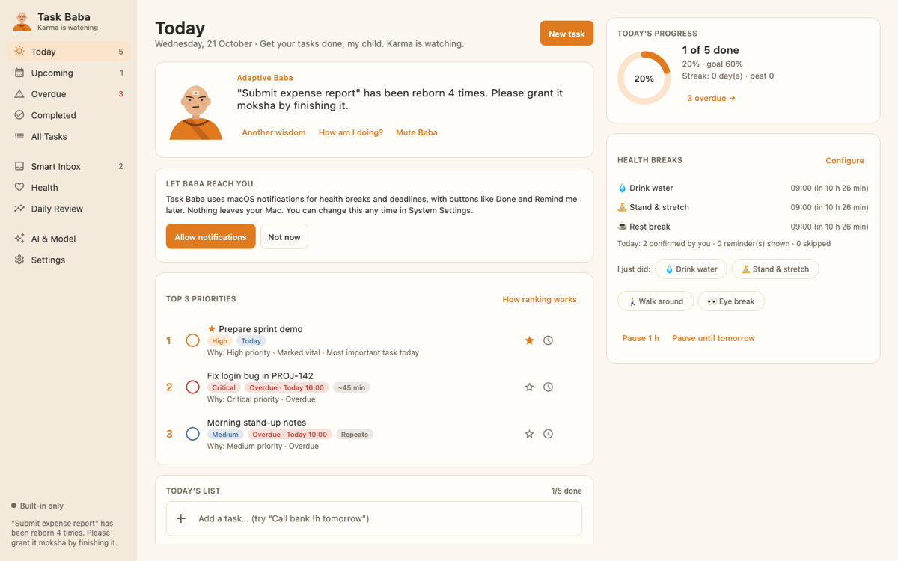
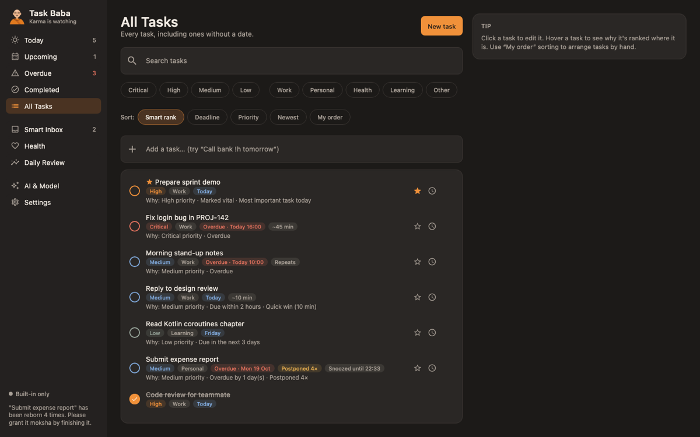
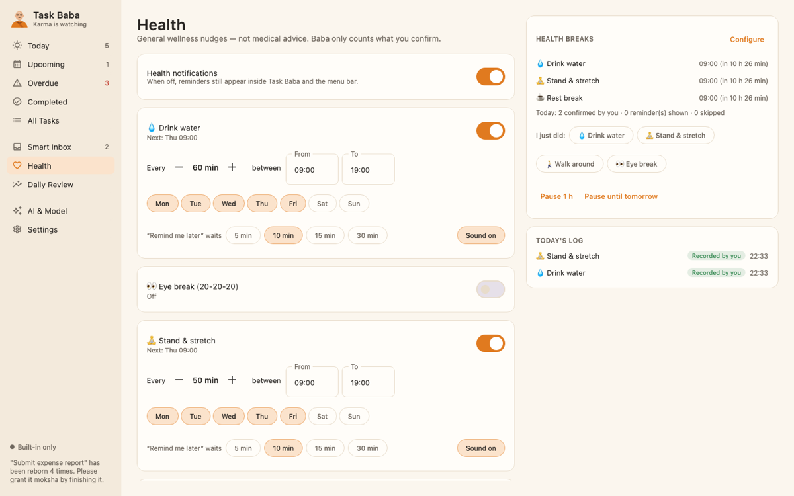
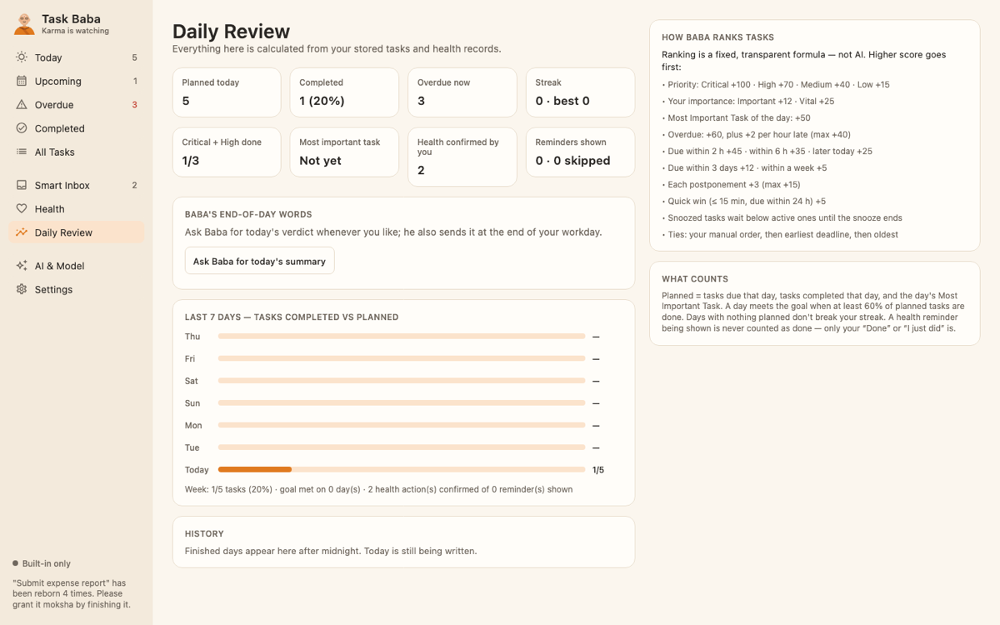

# Task Baba 🧘‍♂️

**Get your tasks done, my child. Karma is watching.**

Task Baba is a native-feeling macOS productivity and health companion with a funny, wise, slightly savage monk. He ranks your tasks, nudges you to drink water and stretch, calls out procrastination (playfully), and celebrates your wins — all **local-first and private by default**.



| Dark mode | Health | Daily review |
|---|---|---|
|  |  |  |

> Screenshots are rendered from the real UI with sample data (`ScreenshotRenderer` test).


## Features

- **Daily tasks** — create, edit, complete, reopen, snooze, reschedule, delete, search, filter and sort. Title, description, notes, category (Work, Personal, Health, Learning, Other), priority (Critical, High, Medium, Low), your own importance flag, due date/time, estimated duration.
- **Views** — Today, Upcoming, Overdue, Completed, All Tasks. One **Most Important Task** per day and a **Top 3** list.
- **Transparent ranking** — a fixed formula (not AI). Hover any task to see *why* it's ranked where it is. Rules are in the app (Daily Review) and in [`TaskRanker.kt`](core/src/main/kotlin/app/taskbaba/core/tasks/TaskRanker.kt).
- **Repeating tasks** — daily, weekdays, weekly. Deterministic instance ids + a unique index guarantee no duplicates; a deleted day's task is never resurrected; missed days aren't back-filled.
- **Health breaks** — water, eye breaks (20-20-20), stretching, walking, meals, rest. Per-reminder enable, interval or fixed meal times, active hours, weekdays, snooze length, sound. Actions: **Done**, **Remind me later**, **Skip**, **Turn off**. Only *your* confirmation counts as done — a delivered reminder never does.
- **Baba's personality engine** — Friendly, Savage, or Adaptive (gets more direct after repeated postponements). 170+ original lines, de-duplicated across restarts, with cooldowns. Mute him, disable sarcasm, set quiet hours, cap notifications per hour. He never shames you about health or breaks.
- **Animated Baba** — a poseable, original character with **40 animations**: he drinks water at water breaks, rests his eyes, stretches, walks, eats, sips chai, taps his watch when a deadline nears, facepalms after the fourth postponement, dances when an important task is done and throws confetti when all priorities are finished. Between events he breathes, blinks, lip-syncs new lines, looks around, counts mala beads, and dozes off late at night. Smoothness is selectable (30 / 40 / 60 fps, default 40); reduced motion shows each move's key pose instead. Preview every move in **Settings → Baba's moves**.
- **Menu bar companion** — today's progress, top priorities (click to complete), quick add, next reminder, snooze controls, AI status, floating-Baba toggle, open window, quit. The app keeps running when the window is closed.
- **Floating Baba** (optional) — small always-on-top window, draggable, never steals keyboard focus, remembers its position, clamps to connected displays, respects reduced motion.
- **Daily review & stats** — planned vs completed, completion %, overdue count, Critical/High completion, MIT, current and best streak, health actions confirmed vs reminders shown, 7-day view, history (deletable), and Baba's end-of-day summary. Finished days are frozen into history at rollover; nothing is deleted by the daily reset.
- **Smart Inbox** (optional) — official-API integrations with **Jira Cloud**, **Slack** and **Microsoft 365** (Teams chats, Outlook mail, Calendar) classified by deterministic rules, with focus sessions, digests and follow-up-task creation. See [Notification integrations](#notification-integrations).
- **Optional AI** — Baba's in-app lines can be rewritten by **your own model, stored in your Google Drive and run in Google Colab**. Without it (or offline) he uses his built-in library. See [AI: Google Drive + Colab](#ai-google-drive--colab).

## Requirements

| | |
|---|---|
| macOS | **13 Ventura or later** (deployment target 13.0 — needed for `SMAppService` launch-at-login). Built and tested on macOS 15.6 (Apple Silicon). |
| Build | JDK 17+, Swift 5.9+ toolchain (Xcode **or** just the Command Line Tools). Gradle is provided by the wrapper. |
| Stack | Kotlin 2.2.21, Compose Multiplatform 1.9.3 (Material 3), SQLDelight 2.1 on SQLite, kotlinx.coroutines/serialization, and a small Swift helper (`babakit`) for UserNotifications, Keychain and launch-at-login. |

## Build & run

```bash
git clone https://github.com/Shubhamgarg1072/task-baba.git
cd task-baba

./gradlew test                 # unit tests (core + app)
scripts/build-app.sh           # builds and ad-hoc signs "Task Baba.app"
open "app/build/compose/binaries/main/app/Task Baba.app"
```

Copy the app to `/Applications` to keep it. It is ad-hoc signed, not notarized: if you download a build from elsewhere, right-click → **Open** the first time.

Development run (separate data folder, native bridge from `native/`): `scripts/run-dev.sh`. `./gradlew :app:run` also works but without native notifications (falls back to simple banners).

Data lives in `~/Library/Application Support/TaskBaba/` (override with `TASKBABA_HOME`). Delete that folder to start fresh, or use **Settings → Reset all data**.

## Permissions

| Permission | Why | When it's asked |
|---|---|---|
| Notifications | Health reminders and deadline alerts with action buttons | Only when you press **Allow notifications** (Today screen or Settings). If denied, reminders still appear in the app and menu bar. |
| Login item | Optional launch at login so reminders keep running | When you turn on **Launch at login**. macOS may ask you to approve it in System Settings → General → Login Items. |
| Keychain | Stores API keys/tokens for integrations and AI | Transparently; ad-hoc rebuilds may cause macOS to ask again. |

Task Baba does not use Accessibility, Screen Recording, Full Disk Access or any private API.

## Architecture

```
app/   Compose desktop UI (windows, menu bar, floating Baba) + platform bridge (Kotlin ⇄ babakit)
core/  Pure Kotlin/JVM: domain, persistence, services — fully unit-tested
native/babakit   Swift helper: UserNotifications, Keychain, SMAppService (JSON lines over stdio)
cloud/           Colab notebook, auth/limits proxy, portable server (not deployed)
```

| Module (core) | Responsibility |
|---|---|
| `model/` | Tasks, deadlines (`Due.OnDate` follows your time zone, `Due.At` is absolute), health configs, settings |
| `data/` | SQLDelight schema (`*.sq`), repositories, typed key-value settings store |
| `tasks/` | `TaskService` (validation, postponements, MIT, ordering), `TaskRanker`, `RecurrenceEngine` |
| `reminders/` | `HealthSchedule` (pure scheduling math: active hours, weekdays, quiet hours, DST), `NotificationPolicy` (quiet hours, pause, hourly cap) |
| `monk/` | `MessageLibrary` + `MonkEngine` (tone resolution, de-duplication, cooldowns, muted wording) |
| `app/ui/monk/rig/` | Baba's rig: `Pose` (every animatable parameter, 2-bone IK arms), `BabaRenderer`, the 40-clip keyframe library, `BabaDirector` (event → clip), `BabaPerformer` (crossfades, blinks, lip-sync, idle variety) and `FramePacer` |
| `stats/` | `StatsCalculator` (daily records, streaks, health delivered vs confirmed) |
| `BabaCore` | Orchestrates the 20-second scheduling loop, day rollover, notifications and their responses |
| `ai/` | `AiRouter` (modes, health-checked routing, timeouts, dedup), `CloudInferenceClient`, `PromptBuilder`, `OutputValidator` |
| `drive/` | Google OAuth (loopback + PKCE), Drive metadata client, model catalog & verifier |
| `integrations/` | Source adapters, classifier, notification gate, inbox service |

Key reliability choices:
- Reminders run in the app's own loop (not pre-scheduled in Notification Center), with state persisted per reminder. Restarts don't duplicate reminders; reminders missed by more than 30 minutes (Mac asleep, app closed) are rescheduled instead of fired in a burst.
- Notifications always use the deterministic library text — AI never delays a reminder.
- A single-instance lock prevents two copies from double-notifying.
- Time is injected (`ClockProvider`) and the time zone is read on every tick, so travelling and DST changes apply live.
- Animation is battery-aware. Compose Desktop repaints the whole window on every frame, so Baba requests frames only when one is due: your chosen 30/40/60 fps during reactions, blinks and lip-sync, about 5 fps while he's just breathing, and none at all in the main window while it isn't focused. Measured on an M1 (Activity Monitor-style % of one core): about 1 % with the window in the background, about 9 % while you're looking at the Today screen, and about 8 % extra for the optional Floating Baba. Set `TASKBABA_DEBUG_FPS=1` to log real frame rates.

## AI: Google Drive + Colab

Google Drive is **storage, not compute** — it can't run a model. So:

1. The model file (default **Qwen3-4B-Q4_K_M**, 2.50 GB, Apache-2.0; lighter option Qwen3-1.7B-Q8_0) lives in your private `MyDrive/TaskBaba/models`.
2. The [Colab notebook](cloud/colab/README.md) downloads it into Drive once (pinned revision, SHA-256 verified, resumable, previous version kept for rollback), runs llama.cpp's server behind an auth + limits proxy, and exposes it through an HTTPS tunnel with a random API key.
3. In **Task Baba → AI & Model**, pick a mode, consent, paste the endpoint and key (stored in Keychain), and press **Check connection** / **Test inference**.
4. Optionally connect Google Drive (read-only **metadata** scope) so the app can verify the model file's size and SHA-256 — it never downloads the model.

| Mode | Behaviour |
|---|---|
| Built-in only (default) | Never sends anything anywhere. |
| Automatic | Uses your Colab endpoint when its `/health` check passes; otherwise built-in lines; switches back automatically. |
| Cloud only | Colab endpoint or built-in lines — nothing else is tried. |

**Privacy:** cloud modes require explicit consent. Only the event type, Baba's built-in line, counts (e.g. "3 of 5 done") and — only if you allow it — a task title are sent. Never descriptions, notes, deadlines, health data or notification content. AI output is validated (length, no links/code/instructions) and is display text only; it can never change tasks, settings or reminders.

**Colab caveats:** free sessions stop when idle or after their lifetime limit, GPUs aren't guaranteed, and quick-tunnel URLs change every session (paste the new one). A portable Docker server for a paid host is in [`cloud/server/`](cloud/server/README.md) with cost notes — nothing is deployed for you.

**Google Drive setup** (only for verification): create a Google Cloud project, enable the Drive API, configure the OAuth consent screen (External, add yourself as a test user), create an OAuth client of type **Desktop app**, and paste its client ID (and secret) into AI & Model. Tokens are stored in Keychain and revoked on disconnect.

## Notification integrations

macOS does **not** let one app read another app's notifications, and Task Baba won't work around that. Instead it uses official APIs:

| Source | How | Notes |
|---|---|---|
| Jira Cloud | Site URL + email + API token | Issues assigned to / reported by / watched by you. Jira search can't find @mentions. |
| Slack | Your own Slack app's user token with `search:read` | Mentions and DMs via `search.messages`. |
| Microsoft 365 | Device-code sign-in with your Azure app's client ID | Unread mail, recent Teams chat messages, meetings in the next 2 h. Some orgs require admin consent for `Chat.Read`. |
| Other macOS apps, browser PWAs, generic webhooks | **Not supported** | Shown in Settings with the reason. No fake data. |

Items are classified **Critical / High / Normal / Low / Noise** by your rules first (source, sender, channel/project, keywords, mentions, urgency, focus state, time), then built-in rules; your per-item override always wins. No AI classification in 1.0. Actions are limited to what's real: open original, snooze, create or link a task, change priority, mark **reviewed** (Task Baba's own state — it never marks anything read in the source app). Focus sessions, quiet hours, urgent exceptions, digests, allowlists, duplicate suppression, an hourly cap and pause/resume are supported. Stored items are purged after 7 days by default.

## Privacy

- No analytics, telemetry, accounts or servers of ours. Task data stays in a local SQLite database.
- Secrets (AI key, OAuth tokens, integration tokens) are stored only in the macOS Keychain, never in the database, logs or source.
- Network access happens only for features you turn on (Colab endpoint, Google Drive metadata, Jira/Slack/Microsoft).
- Model backups contain model files only — never tasks, health or notification data.

## Testing

```bash
./gradlew test                                  # 152 JVM tests
python3 cloud/proxy/test_taskbaba_proxy.py      # proxy auth/limits tests
```

Covered: animation library integrity (every clip well-formed and ending at rest), event→clip mapping for every event and tone, frame pacing at 30/40/60 fps on 60 Hz and 120 Hz displays, IK bone lengths, crossfades/blinks/lip-sync/idle variety, plus ranking and deadline ordering, recurrence and duplicate prevention (incl. DST), statistics and streaks, monk selection/de-duplication/cooldowns, reminder scheduling (active hours, quiet hours, pause, sleep/stale, DST), permission denial, restart persistence, settings persistence, AI routing (healthy, offline, cloud down, timeout, recovery, built-in never calls out, slow inference doesn't block reminders), invalid AI output, Drive auth denial and checksum mismatch, integration adapters (401/403/429/500/offline/duplicates/unsupported), notification gate decisions, the native-bridge protocol, and an offscreen render of every screen in light and dark mode. External services are always mocked.

## Known limitations

- Reminders fire while Task Baba is running; turn on **Launch at login** to keep them going.
- Builds are ad-hoc signed, not notarized.
- Notification button handling, real Colab runs, and real Jira/Slack/Microsoft/Google accounts were verified only against mocks in automated tests (see [CHANGELOG](CHANGELOG.md)).
- "Return from break" is detected when you come back to the Task Baba window after 30+ minutes, not system-wide idle time.
- Some Material components render in Compose rather than AppKit, so a few controls look slightly less native than SwiftUI.

## Roadmap

- Notarized releases and auto-update
- Optional AI-assisted inbox classification (consented, local rules first)
- Gmail / Google Calendar adapters; a site-scoped browser extension for selected PWAs
- Richer recurrence (custom days, monthly)
- Widgets and Focus-mode integration

## Contributing & licence

See [CONTRIBUTING.md](CONTRIBUTING.md), [SECURITY.md](SECURITY.md) and [CODE_OF_CONDUCT.md](CODE_OF_CONDUCT.md). Original code is [MIT](LICENSE). Third-party components and the model keep their own licences — see [THIRD_PARTY_NOTICES.md](THIRD_PARTY_NOTICES.md).
